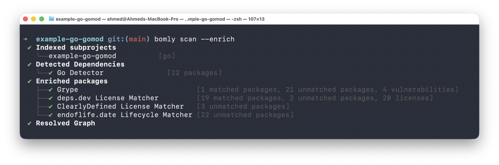
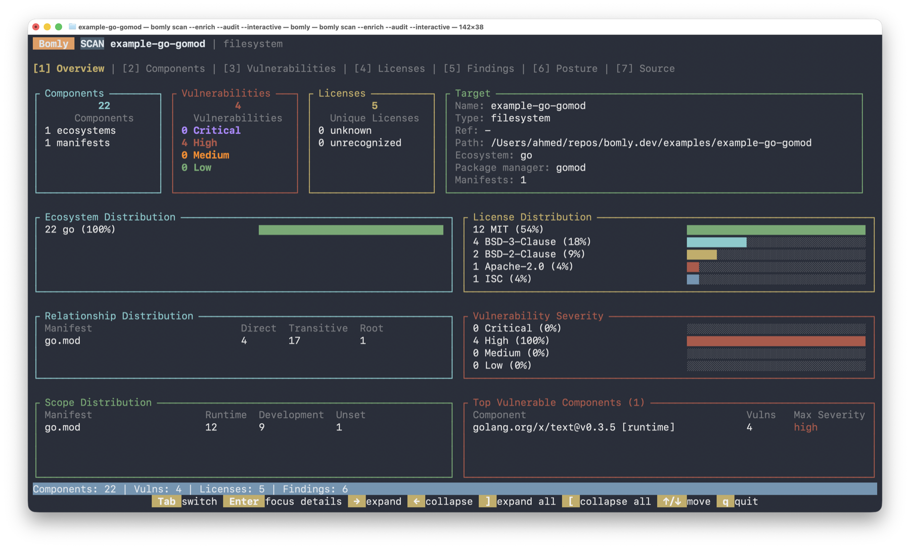
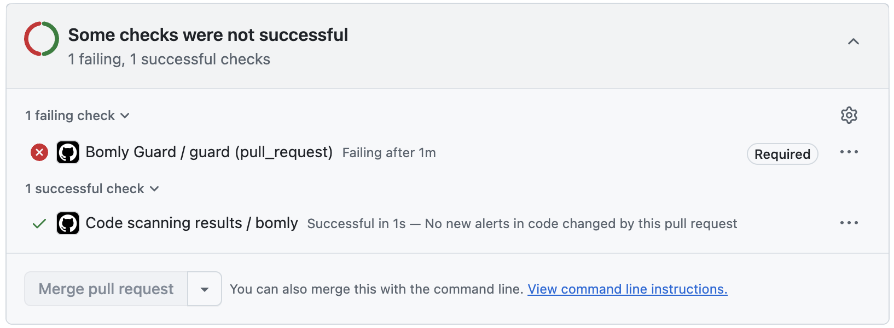

<p align="center">
  
</p>

<p align="center">
  <strong>Analyze Your Software DNA.</strong>
</p>

<p align="center">
  <a href="https://github.com/bomly-dev/bomly-cli/actions/workflows/ci.yml"></a>
  <a href="https://scorecard.dev/viewer/?uri=github.com/bomly-dev/bomly-cli"></a>
  <a href="https://github.com/bomly-dev/bomly-cli/releases/latest"></a>
  <a href="https://github.com/bomly-dev/bomly-cli/releases"></a>
  <a href="LICENSE"></a>
  <a href="https://pkg.go.dev/github.com/bomly-dev/bomly-cli"></a>
</p>

Bomly is a free, open-source command-line tool for understanding what your software depends on. It is built for developers, security engineers, and CI pipelines. Bomly:

- scans source trees, SBOMs, Git refs, and container images into one dependency graph;
- explains why a package is present;
- adds vulnerability and license data when you ask for it with `--enrich`;
- checks the result against your policy and exits with a code CI can act on;
- writes JSON, SARIF, SPDX, and CycloneDX output.

No account, no login, no service to host, no telemetry. One binary. Bomly contacts no vulnerability or license service unless you pass `--enrich`. [Network and privacy](docs/NETWORK.md) lists every network trigger so you can check that claim yourself.

## Install

```bash
# macOS / Linuxbrew
brew install bomly-dev/tap/bomly

# Linux / macOS install script
curl -fsSL https://bomly.dev/install.sh | sh

# Windows
winget install Bomly.BomlyCLI
```

Check the install with `bomly version`. [Installation](docs/INSTALLATION.md) covers Linux packages, Scoop, `go install`, the smaller `bomly-lite` binary that uses your own Syft and Grype, checksums, and uninstalling.

## Start with a scan

```bash
# Scan the current project
bomly scan

# Scan a specific directory
bomly scan --path ./services/api

# Scan a container image
bomly scan --image ghcr.io/example/app:latest

# Scan a remote Git ref
bomly scan --url https://github.com/owner/repo --ref v1.2.3

# Read an existing SPDX or CycloneDX SBOM
bomly scan --sbom --path ./sbom.cdx.json
```

Bomly reads manifests, lockfiles, package-manager output, container layers, or existing SBOMs and turns them into one dependency graph. Native detectors cover Go, npm, pnpm, Yarn, Maven, Gradle, Python, Composer, Bundler, GitHub Actions, and more. Syft covers the remaining ecosystems and container images. See the [Support matrix](docs/SUPPORT_MATRIX.md) and [Scan targets](docs/SCAN_TARGETS.md).

<p align="center">
  
</p>

## What Bomly can answer

| Question | Command | Read more |
| --- | --- | --- |
| What do we depend on? | `bomly scan` | [Getting started](docs/GETTING_STARTED.md) |
| Which packages have known vulnerabilities, and is there a fix? | `bomly scan --enrich` | [Matchers](docs/MATCHERS.md) |
| Should this build fail? | `bomly scan --enrich --audit --fail-on high` | [Auditors](docs/AUDITORS.md), [Exit codes](docs/EXIT_CODES.md) |
| Which findings can my code reach? (experimental) | `bomly scan --enrich --audit --analyze --fail-on high --fail-on reachable` | [Reachability](docs/REACHABILITY.md) |
| Why is this package here? | `bomly explain lodash` | [explain](docs/commands/explain.md) |
| What changed in this PR? | `bomly diff --base main --head HEAD --enrich --audit` | [diff](docs/commands/diff.md) |
| Give me an SBOM | `bomly scan -o spdx=sbom.spdx.json -o cyclonedx=sbom.cdx.json` | [SBOM formats](docs/SBOM.md) |
| Give me something CI can read | `bomly scan --json`, `--format sarif` | [Output formats](docs/OUTPUT_FORMATS.md) |

Reachability is experimental: "unreachable" is not a guarantee of safety. [Use cases](docs/USE_CASES.md) has more recipes, and [Release assurance](docs/ASSURANCE.md) lists the checks every release goes through.

## Explore interactively

Open the terminal UI when you want to inspect a graph by hand:

```bash
bomly scan --interactive
```

Use it to fuzzy-find packages, inspect versions and scopes, pivot through findings, and see how a dependency entered the graph without writing a report to disk. See [Interactive TUI](docs/TUI.md).

<p align="center">
  
</p>

## Gate pull requests

The [Bomly Guard action](https://github.com/bomly-dev/bomly-guard) runs `bomly diff` against a pull request's merge base and posts the result as a check and a PR comment. Only the packages the PR changed are audited, so existing findings elsewhere never block a PR:

```yaml
# .github/workflows/bomly.yml
- uses: actions/checkout@v5
  with:
    fetch-depth: 0
- uses: bomly-dev/bomly-guard@v1
  with:
    fail-on: high
```

See [Bomly Guard](docs/BOMLY_GUARD.md). [CI integration](docs/CI_INTEGRATION.md) has recipes for GitLab, Jenkins, Azure DevOps, and CircleCI.

<p align="center">
  
</p>

## Use Bomly with AI agents

Bomly can run as a local server for the Model Context Protocol (MCP), so an AI coding agent can call the same `scan`, `explain`, and `diff` tools you use on the command line:

```bash
bomly mcp serve
```

If you have not installed the CLI, the `bomly-mcp` npm wrapper starts the same server:

```bash
npx -y bomly-mcp
```

See [MCP server](docs/MCP.md) for the Claude Code, Cursor, and VS Code setup and the tool reference.

## Configure and extend

Bomly reads settings from `~/.bomly/config.yaml`, then from the file named by `--config` or `BOMLY_CONFIG`, then from `BOMLY_*` environment variables, then from flags. Later sources win. A config file inside a repository is never loaded on its own: pass `--config .bomly/config.yaml` to use one. See the [Config reference](docs/CONFIG_REFERENCE.md).

Plugins add detectors, matchers, auditors, and analyzers without forking Bomly:

```bash
bomly plugins install github:bomly-dev/bomly-plugin-bun-lock-detector@v0.1.0
bomly plugins enable bomly.examples.detector.bun-lock
bomly plugins verify bomly.examples.detector.bun-lock
```

See [Plugins](docs/PLUGINS.md) to install and trust plugins, and [Plugin authoring](docs/plugins/authoring.md) to write one.

## Documentation

- [Getting started](docs/GETTING_STARTED.md) — install Bomly and run your first scan
- [Tutorial](docs/TUTORIAL.md) — from first scan to a CI gate on a real project
- [Use cases](docs/USE_CASES.md) — recipes for PR gates, SBOMs, triage, licenses, and offline scans
- [FAQ](https://bomly.dev/faq) — quick answers on privacy, accounts, and tool differences
- [Scan targets](docs/SCAN_TARGETS.md) and [Monorepos](docs/MONOREPOS.md) — what Bomly can scan
- [Output formats](docs/OUTPUT_FORMATS.md) and [SBOM formats](docs/SBOM.md) — text, JSON, SARIF, SPDX, CycloneDX
- [CI integration](docs/CI_INTEGRATION.md) and [Bomly Guard](docs/BOMLY_GUARD.md) — pipelines and the GitHub Action
- [MCP server](docs/MCP.md) — connect Bomly to Claude Code, Cursor, VS Code, or another MCP client
- [Reachability](docs/REACHABILITY.md) — experimental triage by whether your code can reach a vulnerability
- [Plugins](docs/PLUGINS.md) — external detectors, matchers, auditors, and analyzers
- [Release notes](https://github.com/bomly-dev/bomly-cli/releases) — what changed in each version
- [All documentation](docs/README.md) — the full index

Contributor setup lives in [CONTRIBUTING.md](CONTRIBUTING.md). Architecture details live in [docs/ARCHITECTURE.md](docs/ARCHITECTURE.md).

## Questions and sponsorship

For questions, ideas, and help, use [Bomly Discussions](https://github.com/orgs/bomly-dev/discussions). Use this repository's issues for confirmed bugs, regressions, and concrete implementation work.

If Bomly is useful to you, star the repository, share feedback, contribute, or [sponsor ongoing maintenance](https://bomly.dev/support).

## License

Bomly CLI is licensed under the [Apache License 2.0](LICENSE).
