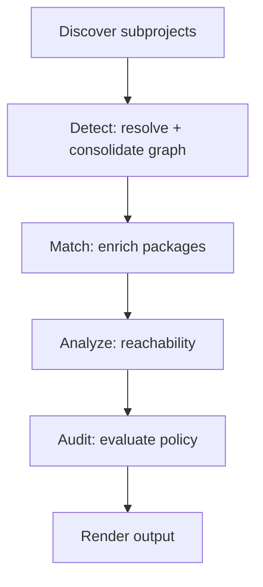
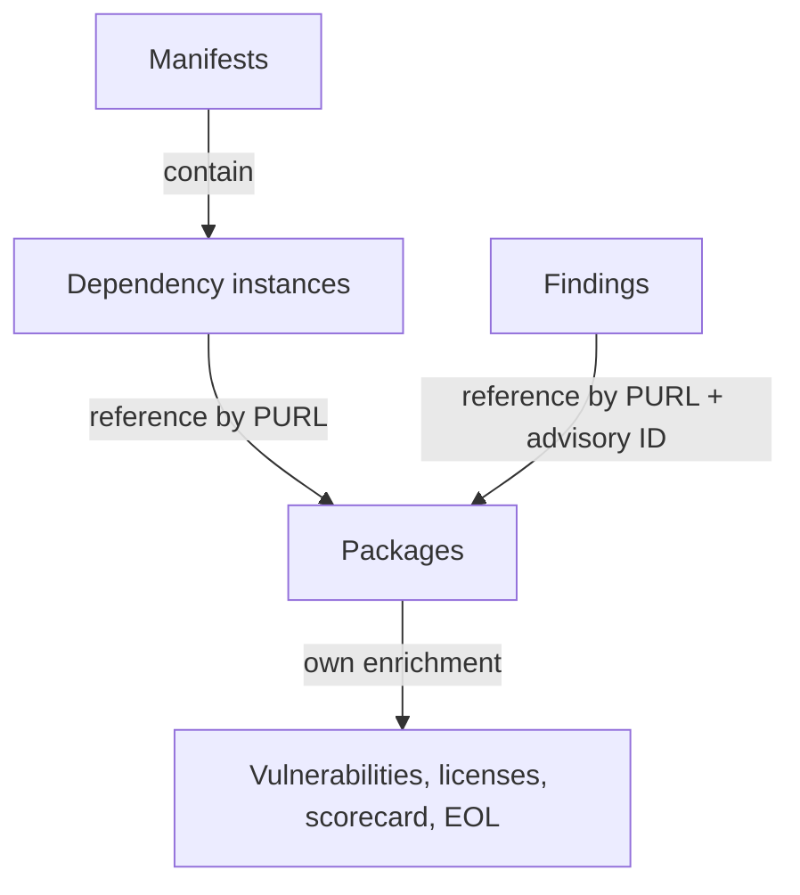
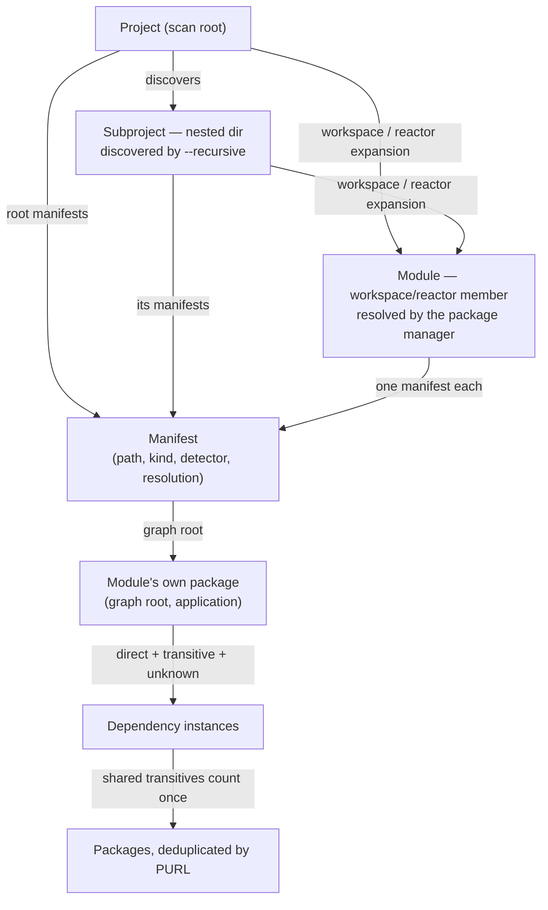

# Architecture

This page explains how Bomly turns a scan target into a report: the stages a scan runs through, the data it produces, and how the pieces can be extended. It is for readers who want to understand the output, not for contributors to the code; the contributor version is [`dev-docs/ARCHITECTURE.md`](https://github.com/bomly-dev/bomly-cli/blob/main/dev-docs/ARCHITECTURE.md).

## Commands

Three commands run the pipeline described here, and four support it. Every run works on exactly one target: a directory, a container image, a remote Git repository, or an SBOM file. See [Commands](COMMANDS.md) and [Scan targets](SCAN_TARGETS.md).

## The scan pipeline

A scan runs through a fixed sequence of stages. Each stage hands its output to the next, so later stages always see one consolidated view of your dependencies.

| Stage | Runs | What it does |
| --- | --- | --- |
| **Discover** | Always | Finds every supported project root at the target (a `go.mod`, a `package-lock.json`, a `pom.xml`, and so on). With `--recursive` it also walks nested directories; workspace-aware package managers expand their own modules from the root. See [Monorepos](MONOREPOS.md) |
| **Detect** | Always | For each root, a [detector](DETECTORS.md) reads the lockfile, manifest, or SBOM and resolves a dependency graph. The per-project graphs are consolidated into one graph and one deduplicated package set. `--scope` narrows the graph here |
| **Match** | With `--enrich` | [Matchers](MATCHERS.md) add vulnerabilities, licenses, end-of-life status, and project health scores to the packages. Bomly then derives one fix suggestion per vulnerable package from that evidence. Project roots, workspace members, and local, Git, or URL packages stay in the graph but are not looked up in registries |
| **Analyze** | With `--analyze` | [Reachability](REACHABILITY.md) analysis marks each vulnerability as reachable or not from your code |
| **Audit** | With `--audit` | [Auditors](AUDITORS.md) evaluate your policy (severity thresholds, license rules, denied packages) against the enriched data and produce findings. A [baseline](BASELINES.md) can mark a finding as accepted without removing it |
| **Render** | Always | Writes the result as text, JSON, SARIF, or an SBOM. See [Output formats](OUTPUT_FORMATS.md) |

Detection reports its non-fatal problems as warnings, each with a type:

| Warning type | Meaning | Coverage |
| --- | --- | --- |
| `resolution-failure` | A detector chain failed, and its project is missing from the graph | Reduced; findings may be missing |
| `fallback` | A fallback detector produced the graph, so transitive dependencies may be missing | Reduced; findings may be missing |
| `package-manager` | The graph is complete, but the project's configuration will break an install elsewhere | Complete. See [CI-readiness warnings](CI_READINESS.md) |

Warnings appear in the progress output, in the text and Markdown reports, and in the `warnings` collection of the JSON document.

`bomly explain` reuses the detect and match stages, then traces every path that pulls in the package you name. `bomly diff` runs the pipeline on two states and reports added, removed, and changed packages, plus changes to a dependency's relationship, source, or registry eligibility. See the [diff command](commands/diff.md).

## Domain model

Bomly keeps three kinds of data apart, which is why the same fact never appears twice in the output:

| Kind | What it is | What it carries |
| --- | --- | --- |
| **Dependency** | One occurrence of a package in a manifest: a node in the detection graph | Its scope, where it was found, and its edges to other dependencies. It points at a package by PURL and holds no license or vulnerability data |
| **Package** | One unique package across the whole scan, keyed by [PURL](GLOSSARY.md) | The enrichment: licenses, vulnerabilities, fix status and suggestions, scorecard, end-of-life status. If 50 dependencies reference `react@18.2.0`, they share one package and one set of CVEs |
| **Finding** | An audit result | A policy outcome that points back at a package (and, for a vulnerability, at one advisory) instead of copying the data |

In JSON these are the three top-level collections `manifests` (with their `dependencies`), `packages`, and `findings`. [JSON schemas](SCHEMAS.md) documents every field.

Manifests hang off the project structure. A **subproject** is an independent project in a nested directory, found by `--recursive`. A **module** is a workspace or reactor member the package manager resolves itself, with its own manifest entry. The human-readable views merge a project or module with its manifest into one named node. The machine formats keep the flat `manifests` collection and derive the hierarchy from each manifest's `subproject` and `path` fields. The diagram below shows how the pieces relate; [Monorepos](MONOREPOS.md) explains the terms.

Fix suggestions are derived during enrichment by one central component, which chooses the status, the recommended version, and the per-occurrence action. Detectors may contribute package-manager advice, but they cannot choose the final action or edit files.

## Extensibility

Every built-in component implements the same contract an external plugin implements. There are four extension points:

| Extension point | Responsibility |
| --- | --- |
| Detector | Turn evidence (a lockfile, a manifest, an SBOM) into a dependency graph |
| Matcher | Add vulnerability, license, or lifecycle data to packages |
| Auditor | Evaluate policy and produce findings |
| Analyzer | Mark vulnerabilities as reachable or not for one language |

External plugins run as separate processes and stay disabled until you enable them. Once enabled they have the same privileges as Bomly. See [Plugins](PLUGINS.md) for installing and trusting them, and [Plugin authoring](plugins/authoring.md) for writing one.

## Network behavior and trust

A plain `bomly scan` contacts no vulnerability or license service. Enrichment runs only with `--enrich`, remote targets only with `--url` or `--image`, and a build-tool detector may download dependencies when it cannot read a lockfile. [Network and privacy](NETWORK.md) lists every trigger and what it transmits. [Security and trust boundaries](SECURITY.md) covers configuration trust, resource limits, and the plugin trust model.

## Build variants

Bomly ships as two binaries. `bomly` has the Syft and Grype libraries built in and needs no other tools. `bomly-lite` runs the `syft` and `grype` binaries on your `PATH` and is a smaller download. Both behave the same on the command line. See [Installation](INSTALLATION.md).
